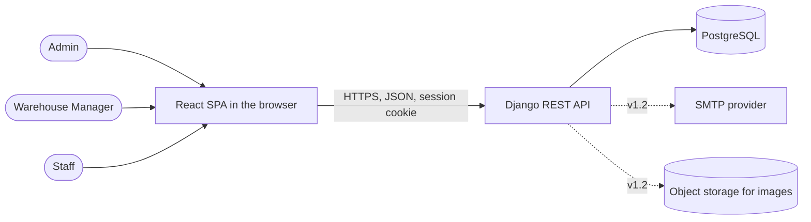
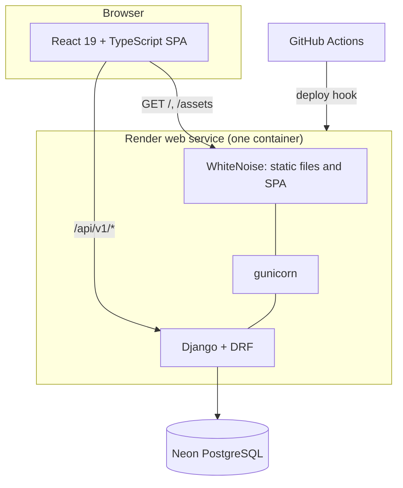
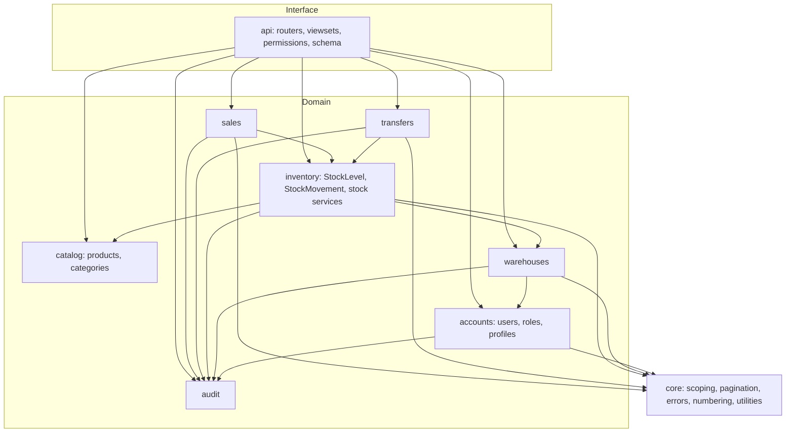
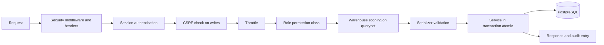
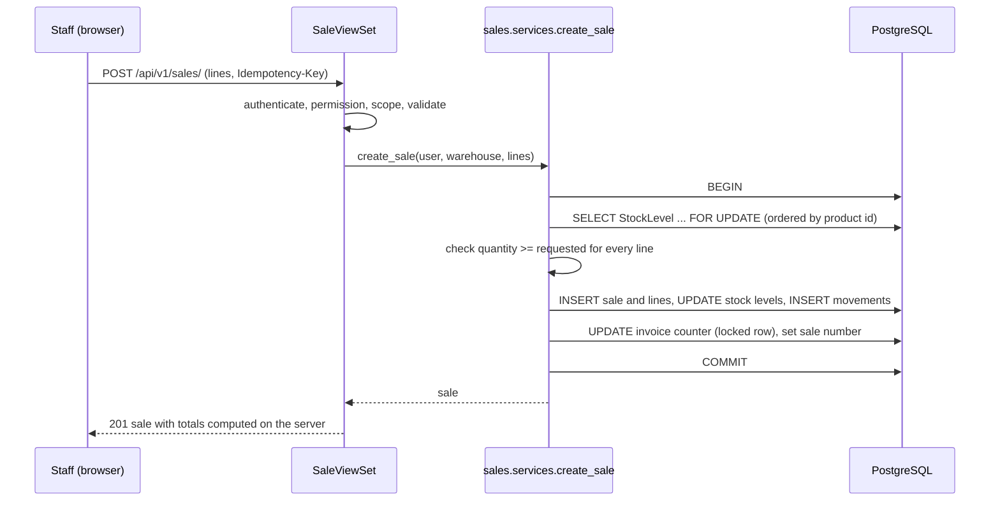
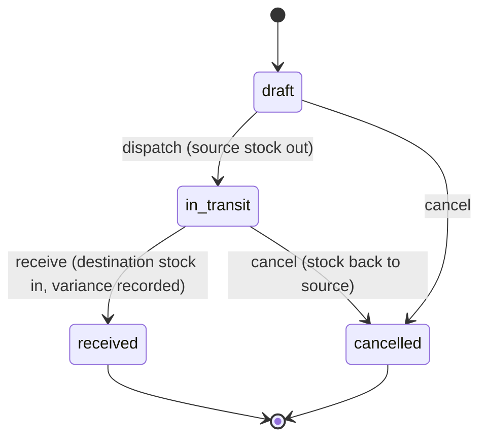
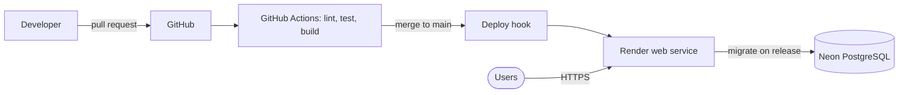

# Architecture

| | |
| --- | --- |
| Product | InvLab |
| Version | 0.1 (draft) |
| Date | 2026-10-12 |
| Related | [TRD.md](TRD.md), [DATABASE.md](DATABASE.md), [API.md](API.md) |

Diagrams use Mermaid and render on GitHub.

## 1. Overview

InvLab is a **modular monolith**: one Django application split into focused apps, a React single-page app, and one PostgreSQL database. In production Django serves both the JSON API and the built SPA, so the browser talks to a single origin. That keeps session cookies and CSRF simple and removes cross-origin configuration.

Three rules shape everything:

1. **The server decides.** Permissions, warehouse scoping, stock checks and totals are enforced in Django.
2. **Services own business logic.** Views validate and delegate; services run the transaction, lock rows and write the ledger.
3. **Every stock change is a movement.** Quantity changes and ledger entries happen together or not at all.

## 2. System context



## 3. Containers



## 4. Backend modules

Each Django app owns its models, services, serializers and views. Dependencies point downward only.



Later releases add `customers`, `purchasing`, `reports`, `notifications` and `settings` apps in the same pattern.

### Layer responsibilities

| Layer | Does | Does not |
| --- | --- | --- |
| Views and viewsets | Authenticate, check permissions, validate input with serializers, call a service, shape the response | Contain business rules or touch stock directly |
| Services | Open transactions, lock rows, enforce rules, write movements and audit entries, raise domain errors | Know about HTTP |
| Models | Fields, constraints, simple helpers | Hold workflow logic |
| Selectors (read helpers) | Build optimised, scoped querysets for lists and dashboards | Change data |

## 5. Request lifecycle



## 6. Role and warehouse scoping

Scoping is implemented once in `core` and reused by every viewset:

- A queryset mixin filters warehouse-owned models by `request.user.profile.warehouse` for Managers and Staff. The Admin sees everything and can narrow with `?warehouse=<id>`.
- Detail lookups use the scoped queryset, so a record from another warehouse produces 404.
- Creation endpoints take the warehouse from the user, not from the request body (Admin may pass one explicitly).
- A test enumerates every URL pattern and fails if a view has no explicit permission class or does not use the scoping mixin where its model has a warehouse.

## 7. Key flows

### 7.1 Confirming a sale



If any check fails, the transaction rolls back and the response is a 409 with a stock message; nothing is saved.

### 7.2 Transfer lifecycle



Dispatch and receive lock stock rows for both warehouses in a fixed order (warehouse id, then product id) to avoid deadlocks.

### 7.3 Stock adjustment

The service locks the stock row, computes the difference, rejects results below zero, updates the quantity, writes an `adjustment` movement with the user and reason, and writes an audit entry, all in one transaction.

## 8. Frontend architecture

```
frontend/src/
  app/            providers, router, route guards, layout shell
  components/ui/  design-system components (Button, Table, Dialog, ...)
  features/
    auth/         login, useAuth, Can, route guards
    warehouses/   overview, detail, forms, api hooks
    users/
    catalog/      products, categories
    stock/        stock table, receive, adjust, ledger
    sales/        new sale, history, receipt
    transfers/
    dashboard/    admin, manager and staff variants
  lib/            api client, formatters (en-IN), query keys, utils
  styles/         tokens (CSS variables), Tailwind layers
```

- **API client:** one wrapper around `fetch` that sends cookies, attaches the CSRF header, parses the standard error body and redirects on 401.
- **Server state:** TanStack Query, with query keys that include the selected warehouse.
- **Forms:** React Hook Form with Zod schemas that mirror server rules; server errors are mapped to fields.
- **Access in the UI:** `useAuth` supplies role and warehouse; `<Can>` hides or disables actions. This is cosmetic; the API enforces access.
- **Code splitting:** routes are lazy-loaded; charts and (later) scanner and PDF tools load on demand.

## 9. Deployment architecture



Environments, variables and release steps are in [DEPLOYMENT.md](DEPLOYMENT.md).

## 10. Architecture decisions

| ID | Decision | Reason | Consequence |
| --- | --- | --- | --- |
| ADR-01 | Modular monolith, not microservices | One team, one database, strong consistency needs for stock | Simple deployment; module boundaries enforced by convention and tests |
| ADR-02 | Django serves the API and the built SPA | Same origin keeps session auth and CSRF simple | One deployable; frontend dev uses a Vite proxy |
| ADR-03 | Session authentication, not JWT | Built in, revocable, no token storage in the browser | Needs same-origin or careful CORS; sessions live in the database |
| ADR-04 | Per-warehouse `StockLevel` table; no cached total on the product | Stock is only meaningful per location; totals are cheap to aggregate | Dashboards aggregate; one source of truth |
| ADR-05 | Append-only `StockMovement` ledger written with every stock change | Traceability and reconciliation | Corrections are new movements; table grows steadily and is indexed |
| ADR-06 | Row locking with `select_for_update` plus a check constraint | Prevents overselling under concurrency | Requires PostgreSQL for concurrency tests |
| ADR-07 | Services layer owns transactions | Keeps rules testable and views thin | Slightly more code than fat views |
| ADR-08 | Warehouse scoping in one shared mixin; foreign records return 404 | Prevents leaks and avoids revealing which ids exist | Every viewset must use it; enforced by a test |
| ADR-09 | Transfers use dispatch and receive with variance | Reflects real goods in transit | Stock "in transit" is not counted in either warehouse |
| ADR-10 | Sale numbers per warehouse and financial year from a locked counter | Gap-free, contention limited to one warehouse | One counter row per warehouse and year |
| ADR-11 | Whole-number quantities | Simpler rules for the first release | Weight or volume units need a later migration |
| ADR-12 | Deactivate instead of delete for records with history | Preserves audit trail | Lists need an active filter |

## 11. Observability

- Structured JSON logs with a request id, user id (not name) and warehouse id.
- `/healthz/` for the platform health check.
- Optional error tracking with request context but no request bodies.
- A management command `check_stock_integrity` reports any stock level that differs from its movements.
