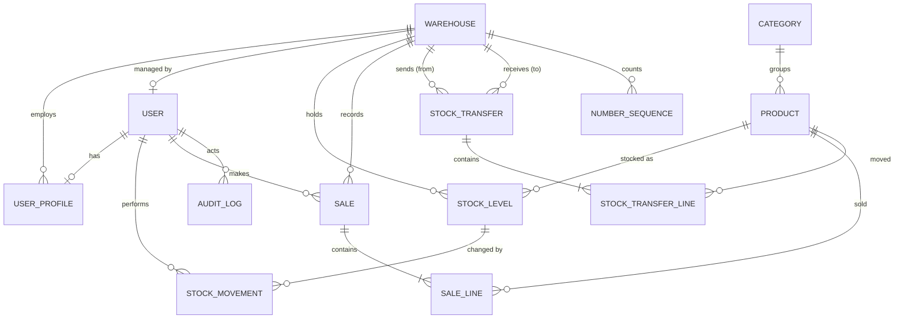

# Database Design

| | |
| --- | --- |
| Product | InvLab |
| Version | 0.1 (draft) |
| Date | 2026-10-12 |
| Related | [ARCHITECTURE.md](ARCHITECTURE.md), [FRD.md](FRD.md) |

Production uses PostgreSQL 16. Tests may use SQLite, except concurrency tests, which need PostgreSQL. Names below are logical; Django generates the final table names (`app_model`).

## 1. Conventions

- Primary keys are `bigint` identity columns unless noted.
- Money is `numeric(12,2)`. Quantities are integers.
- Timestamps are `timestamptz` in UTC: `created_at` set on insert, `updated_at` on change.
- Foreign keys use `PROTECT` unless noted, so history cannot be orphaned.
- Records with history are deactivated using `is_active`, never deleted.
- All migrations are additive and run on SQLite and PostgreSQL.

## 2. Entity relationship diagram (v1.0)

## 3. Tables

### 3.1 accounts

**user** (Django `auth_user` or a custom user model; decide in M0 and keep it)

| Column | Type | Notes |
| --- | --- | --- |
| id | bigint PK | |
| username | varchar(30) | unique, case-insensitive |
| email | varchar(254) | optional for Staff |
| first_name, last_name | varchar(80) | |
| password | varchar | Django hash |
| is_active | boolean | deactivation |
| must_change_password | boolean | default false (set on creation by Admin or Manager) |
| last_login | timestamptz | |

Roles are Django groups: `Admin`, `Warehouse Manager`, `Staff`. Each user has exactly one of them.

**user_profile**

| Column | Type | Notes |
| --- | --- | --- |
| user_id | bigint PK, FK user | one-to-one |
| warehouse_id | FK warehouse, null | null only for Admin |
| phone | varchar(15) | optional |

Constraint: users in the Manager or Staff groups must have a warehouse (checked in the service layer and a test).

### 3.2 warehouses

**warehouse**

| Column | Type | Notes |
| --- | --- | --- |
| id | bigint PK | |
| name | varchar(120) | |
| code | varchar(10) | unique, uppercase |
| address_line1, address_line2 | varchar(160) | line 2 optional |
| city, state | varchar(80) | |
| pincode | char(6) | |
| phone | varchar(15) | |
| email | varchar(254) | optional |
| manager_id | FK user, null | **unique** when not null (one warehouse per manager, one manager per warehouse) |
| is_active | boolean | default true |
| created_at, updated_at | timestamptz | |

### 3.3 catalog

**category**: `id`, `name` (unique, case-insensitive), `is_active`.

**product**

| Column | Type | Notes |
| --- | --- | --- |
| id | bigint PK | |
| sku | varchar(40) | unique, case-insensitive |
| name | varchar(120) | |
| category_id | FK category | |
| unit | varchar(20) | label such as "pcs", "box" |
| price | numeric(12,2) | check price > 0 |
| default_reorder_level | integer | check >= 0 |
| is_active | boolean | |
| created_at, updated_at | timestamptz | |

### 3.4 inventory

**stock_level**

| Column | Type | Notes |
| --- | --- | --- |
| id | bigint PK | |
| product_id | FK product | |
| warehouse_id | FK warehouse | |
| quantity | integer | **check quantity >= 0** |
| reorder_level | integer | check >= 0; defaults from the product |
| updated_at | timestamptz | |

Unique on (`warehouse_id`, `product_id`).

**stock_movement** (append-only)

| Column | Type | Notes |
| --- | --- | --- |
| id | bigint PK | |
| stock_level_id | FK stock_level | |
| product_id, warehouse_id | FKs | duplicated for fast filtering |
| movement_type | varchar(20) | `initial`, `receive`, `adjustment`, `sale`, `transfer_out`, `transfer_in`, `transfer_cancel` (v1.1: `return`, `purchase`) |
| quantity_change | integer | signed, not zero |
| balance_after | integer | quantity after this movement |
| reason | varchar(200) | required for adjustments |
| reference_type | varchar(30) | for example `sale`, `transfer` |
| reference_id | bigint | id of the source record |
| user_id | FK user | |
| created_at | timestamptz | |

No update or delete in application code. Optionally add a database trigger or revoke `UPDATE` and `DELETE` for the app role.

### 3.5 sales

**sale**

| Column | Type | Notes |
| --- | --- | --- |
| id | bigint PK | |
| number | varchar(40) | unique, for example `MUM01/2026-27/000123` |
| warehouse_id | FK warehouse | |
| created_by_id | FK user | |
| financial_year | varchar(7) | `2026-27` |
| total | numeric(12,2) | computed on the server |
| idempotency_key | varchar(64), null | unique per user when present |
| created_at | timestamptz | |

**sale_line**

| Column | Type | Notes |
| --- | --- | --- |
| id | bigint PK | |
| sale_id | FK sale | `CASCADE` is acceptable because lines are never edited alone |
| product_id | FK product | |
| quantity | integer | check > 0 |
| unit_price | numeric(12,2) | copied from the product at sale time |
| line_total | numeric(12,2) | quantity x unit_price |

Unique on (`sale_id`, `product_id`).

### 3.6 transfers

**stock_transfer**

| Column | Type | Notes |
| --- | --- | --- |
| id | bigint PK | |
| number | varchar(40) | unique, for example `TRF/2026-27/000045` |
| from_warehouse_id, to_warehouse_id | FKs | check they differ |
| status | varchar(15) | `draft`, `in_transit`, `received`, `cancelled` |
| note | varchar(200) | optional |
| created_by_id, dispatched_by_id, received_by_id | FK user | last two nullable |
| created_at, dispatched_at, received_at, cancelled_at | timestamptz | |

**stock_transfer_line**: `transfer_id`, `product_id`, `quantity_sent` (check > 0), `quantity_received` (nullable until received, check between 0 and `quantity_sent`), `variance` (generated as sent minus received once received). Unique on (`transfer_id`, `product_id`).

### 3.7 support tables

**number_sequence**: `id`, `scope` (for example `sale:MUM01` or `transfer`), `financial_year`, `last_value`. Unique on (`scope`, `financial_year`). The row is locked with `select_for_update` while a number is issued.

**audit_log** (append-only): `id`, `actor_id`, `action` (for example `user.role_changed`), `target_type`, `target_id`, `before` (jsonb), `after` (jsonb), `created_at`. Index on (`target_type`, `target_id`) and on `created_at`.

## 4. Indexes

| Table | Index | Reason |
| --- | --- | --- |
| stock_level | unique (warehouse_id, product_id) | One row per pair; lookups |
| stock_level | (warehouse_id, quantity) | Low-stock lists |
| stock_movement | (warehouse_id, created_at desc) | Ledger by warehouse |
| stock_movement | (product_id, created_at desc) | Product ledger tab |
| stock_movement | (reference_type, reference_id) | Find movements for a sale or transfer |
| sale | (warehouse_id, created_at desc) | History and dashboards |
| sale | (created_by_id, created_at desc) | Staff "my sales" |
| sale | unique (number) | Lookup and uniqueness |
| product | unique lower(sku); trigram index on name (optional) | Search |
| stock_transfer | (from_warehouse_id, status), (to_warehouse_id, status) | Outgoing and incoming tabs |
| audit_log | (target_type, target_id), (created_at) | Filtering |

## 5. Invariants

| ID | Invariant | Enforced by |
| --- | --- | --- |
| INV-1 | `stock_level.quantity >= 0` | Check constraint and service |
| INV-2 | Sum of `quantity_change` for a stock level equals its `quantity` | Services; `check_stock_integrity` command; test |
| INV-3 | Each movement's `balance_after` equals the quantity right after it | Service writes it from the locked row |
| INV-4 | A warehouse has at most one manager, and a user manages at most one warehouse | Unique constraint on `manager_id` |
| INV-5 | Non-Admin users have a warehouse | Service validation and test |
| INV-6 | Sale total equals the sum of its line totals | Service computes both; test |
| INV-7 | Transfer conservation: units out of the source equal units received plus recorded variance | Service and test |
| INV-8 | Sale and transfer numbers are unique and gap-free per scope and year | Locked counter row |

## 6. Locking and transactions

- Every stock-changing service starts with `transaction.atomic()` and calls `select_for_update()` on the needed `stock_level` rows.
- Rows are locked in a fixed order: by `warehouse_id`, then `product_id`.
- Checks happen after the lock is acquired, never before.
- Numbers are issued after stock is deducted, still inside the same transaction.
- Long-running work (emails, PDF generation) happens after commit.

## 7. Seed data

A `seed_data` management command creates demo data for development and the live demo:

- 1 Admin, 3 warehouses (each with a manager and two staff), 6 categories, about 60 products
- Different stock per warehouse, some at or below the reorder level, one out of stock
- A few days of sales, and one transfer in transit

Seeding is explicit and never runs automatically on deploy. Demo passwords are documented in the README and clearly marked as public.

## 8. Migration plan

1. Create the user model decision, groups and permissions.
2. Warehouses, profiles and the manager constraint.
3. Catalogue.
4. Stock levels and movements with constraints and indexes.
5. Sales, lines and the sequence table.
6. Transfers.
7. Audit log.

Each step ships with its tests. Later releases add tables (customers, payments, returns, suppliers, purchase orders, settings) and columns (cost price, tax fields, barcode, image) as additive migrations.
